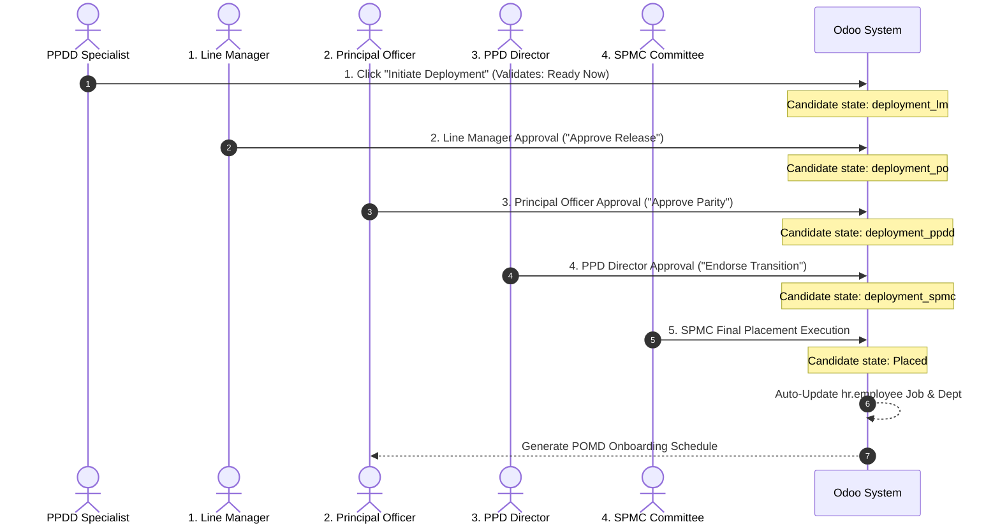

# Bunna Bank Succession Management — Master End-to-End User & Governance Guide

> **Organization:** Bunna Bank S.C.  
> **System Module:** Succession Management (`bunna_succession_management`)  
> **Target Audience:** PPDD Officers, Direct Line Managers, Principal Officers (POMD), PPD Directors, SPMC Executive Committee, and HR Administrators  
> **Version:** 3.0 (Enterprise Production Edition — Date-Driven Readiness & IDP Acceleration)

---

## Table of Contents
1. [Executive Overview & Core Governance Principles](#1-executive-overview--core-governance-principles)
2. [Complete Roles, Personas & Security Matrix (RBAC)](#2-complete-roles-personas--security-matrix-rbac)
3. [Master RACI Governance Matrix](#3-master-raci-governance-matrix)
4. [Master End-to-End Workflow Architecture](#4-master-end-to-end-workflow-architecture)
5. [Phase-by-Phase Step-by-Step Execution Guide](#5-phase-by-phase-step-by-step-execution-guide)
   - [Phase 1: Dynamic Readiness & Policy Configuration (HR Admin)](#phase-1-dynamic-readiness--policy-configuration-hr-admin)
   - [Phase 2: Critical Position Identification & SPMC Approval](#phase-2-critical-position-identification--spmc-approval)
   - [Phase 3: Talent Pool Auto-Discovery & 6-Pillar Matching](#phase-3-talent-pool-auto-discovery--6-pillar-matching)
   - [Phase 4: Candidate Profile & Formal Nomination](#phase-4-candidate-profile--formal-nomination)
   - [Phase 5: Assessment Plan Setup & Criteria Synchronization](#phase-5-assessment-plan-setup--criteria-synchronization)
   - [Phase 6: Career & Aspiration Discussion (Mandatory Dialogue)](#phase-6-career--aspiration-discussion-mandatory-dialogue)
   - [Phase 7: Multi-Rater Competency Evaluation & Exam Marks Recording](#phase-7-multi-rater-competency-evaluation--exam-marks-recording)
   - [Phase 8: Assessment Finalization & Exact Calendar Target Date Horizon](#phase-8-assessment-finalization--exact-calendar-target-date-horizon)
   - [Phase 9: Individual Development Plan (IDP) Progression & Timeline Acceleration](#phase-9-individual-development-plan-idp-progression--timeline-acceleration)
   - [Phase 10: SPMC Executive Candidate Approval](#phase-10-spmc-executive-candidate-approval)
   - [Phase 11: 4-Tier Successor Deployment & Automated HR Placement](#phase-11-4-tier-successor-deployment--automated-hr-placement)
6. [Real-World Bank Lifecycle Walkthrough: Candidate Zinash Desta](#6-real-world-bank-lifecycle-walkthrough-candidate-zinash-desta)
7. [Executive Dashboard, 9-Box Grid & Bench Analytics](#7-executive-dashboard-9-box-grid--bench-analytics)
8. [Master System Gatekeepers & Troubleshooting Matrix](#8-master-system-gatekeepers--troubleshooting-matrix)

---

## 1. Executive Overview & Core Governance Principles

The Bunna Bank Succession Management System guarantees leadership continuity, organizational stability, and transparent meritocratic promotion across all critical banking positions.

### Key Architectural Pillars:
1. **Strict Gatekeeper Integrity:** Progression through each stage is protected by automated Python constraints and database validations. Skipping prerequisites (such as career discussions or competency syncs) is strictly impossible.
2. **Confidentiality by Design:** Succession benches, readiness levels, 9-box grids, and candidate assessment scorecards are strictly confidential. Standard employees have **zero access** to these models.
3. **Multi-Rater Objective Assessment:** Combines Direct Manager behavioral evaluations, Candidate Self-Assessments, SPMC Committee deliberations, verified Written Examinations, Structured Interviews, and historical PMS performance ratings.
4. **Dynamic Calendar-Exact Readiness:** Readiness is not a static text label. The system continuously calculates exact calendar horizons (e.g. **June 2028**), evaluates **Job Grade Gaps** against role feeder grades, and synchronizes target readiness in real time with approved Individual Development Plans (IDPs).
5. **4-Tier Deployment Governance:** No single individual can deploy a successor. Transition requires sequential sign-off: Releasing Manager $\rightarrow$ Principal Officer $\rightarrow$ PPD Director $\rightarrow$ SPMC Final Approval, culminating in automated HR master profile updates.

---

## 2. Complete Roles, Personas & Security Matrix (RBAC)

| Role / Persona | Odoo Security Group | System Persona Description & Concrete Responsibilities | Access Scope & Confidentiality |
| :--- | :--- | :--- | :--- |
| **Succession Creator / PPDD Specialist** | `group_succession_ppdd` | • **Creator:** Identifies Critical Positions, creates Talent Pools, runs algorithmic auto-discovery, nominates candidates, drafts IDPs. • **Coordinator:** Configures Assessment Plans, synchronizes position criteria, coordinates rater inputs, enters verified exam/interview marks, applies readiness suggestions. • **Monitor:** Tracks bench health, IDP milestone progression, and initiates successor deployment. | Full read/write across critical positions, candidates, evaluations, and IDPs across all bank departments. |
| **Direct Line Manager / Evaluator** | `group_succession_line_manager` | • **Dialogue Partner:** Holds, documents, and signs off formal Career & Aspiration Discussions. • **Behavioral Evaluator:** Rates direct reports on required competency behavioral indicators with supporting evidence. • **IDP Mentor / Evaluator:** Mentors candidates on development activities, logs progress %, requests plan extensions, and submits completion reviews. • **Tier-1 Approver:** Executes **Releasing Manager Approval** upon successor deployment. | Strictly restricted by record rules to their own direct reports (`employee_id.parent_id.user_id = uid`). Cannot view peer candidates or positions. |
| **Principal Officer (POMD / HR Ops)** | `group_succession_ppdd` (PO) | • **Workforce Strategist:** Reviews organizational headcount, salary structure parity, and job grade alignment. • **Tier-2 Approver:** Executes **Principal Officer Deployment Approval**. • **Onboarding Lead:** Manages transition logistics and new appointment documentation. | Broad organizational read access; deployment approval permissions. |
| **PPD Director** | `group_succession_ppdd` (Director) | • **Department Endorser:** Reviews and endorses newly drafted Critical Positions before executive submission. • **Readiness Calibrator:** Reviews multi-factor readiness suggestions and approved IDP allocations. • **Tier-3 Approver:** Executes **PPD Director Deployment Approval** confirming executive bench stability. | Full administrative read/write access across all bank succession pipelines. |
| **SPMC Chairperson & Committee (C-Suite / Board)** | `group_succession_spmc` | • **Executive Gatekeeper:** Officially approves Critical Positions (`state = 'approved'`). • **Evaluator:** Evaluates strategic competencies during executive deliberations (when SPMC toggle is ON). • **Candidate Approver:** Officially approves assessed successors into the Ready Bench. • **Tier-4 Final Approver:** Executes **Final SPMC Placement Execution**, triggering automatic HR profile elevation. | Full executive oversight, approval authority, and calibration authority across all pipelines. |
| **Succession Administrator** | `group_succession_admin` | • **System Architect:** Configures Global Governance Policies (Pass Marks, IDP mandatory toggles, Career Discussion mandatory rules). • **Readiness Configurator:** Creates and edits Dynamic Readiness Levels (`min_months`, `max_months`, `min_match_percent`, `max_grade_gap`). • **Superuser:** Maintains assessment component weights and audit trail governance logs. | Full unconstrained read/write/delete/config across all models and menus. |
| **Candidate / Employee** | `base.group_user` (Employee) | • **Participant:** Participates in Career Discussions and self-assessment ratings when enabled. • **Learner:** Executes assigned IDP learning activities (trainings, rotations, certifications). | **Zero visibility** into succession candidate profiles, readiness rankings, 9-box grids, or position succession benches. |

---

## 3. Master RACI Governance Matrix

| Lifecycle Stage | PPDD Creator | Line Manager | Principal Officer | PPD Director | SPMC Committee | HR Admin | Employee |
| :--- | :---: | :---: | :---: | :---: | :---: | :---: | :---: |
| **1. Dynamic Readiness & Policy Setup** | I | I | I | C | C | **A / R** | I |
| **2. Critical Position Creation & Justification** | **R** | C | C | **A** | I | C | I |
| **3. Critical Position Approval** | I | I | I | C | **A / R** | I | I |
| **4. Talent Pool Match & Nomination** | **R** | C | I | I | I | I | I |
| **5. Assessment Plan Setup & Criteria Sync** | **R** | I | I | I | I | A | I |
| **6. Career & Aspiration Discussion** | I | **A / R** | I | I | I | I | **C** |
| **7. Behavioral Competency Evaluation** | C | **R** | I | I | **C (Opt)** | I | **C (Opt)** |
| **8. Exam & Interview Score Entry** | **R** | I | I | I | I | A | I |
| **9. Mark as Assessed & Date Horizon** | **R** | I | I | C | C | A | I |
| **10. IDP Creation, Tracking & Activation** | **R** | **R** | I | I | I | A | **C** |
| **11. SPMC Candidate Approval** | C | I | I | C | **A / R** | I | I |
| **12. Deployment Tier 1: Line Manager Approval** | I | **A / R** | I | I | I | I | I |
| **13. Deployment Tier 2: Principal Officer Approval** | I | I | **A / R** | I | I | I | I |
| **14. Deployment Tier 3: PPD Director Approval** | I | I | I | **A / R** | I | I | I |
| **15. Deployment Tier 4: Final SPMC Placement** | I | I | I | I | **A / R** | I | I |
| **16. Automated HR Profile Promotion** | I | I | I | I | I | **A / System** | I |

*Legend: **R** = Responsible (Executes), **A** = Accountable (Approves), **C** = Consulted (Provides Input), **I** = Informed (Notified).*

---

## 4. Master End-to-End Workflow Architecture

```mermaid
flowchart TD
    subgraph PHASE1["1. Governance & Critical Position Setup"]
        ADMIN_CFG["Admin Configures Readiness Tiers<br/>(Months, Pass Mark, Grade Gaps)"] --> CP_CREATE["PPDD Creates Critical Position<br/>(Criticality Reason + Vacancy Horizon)"]
        CP_CREATE --> CP_PPD["PPD Director Endorsement"]
        CP_PPD --> CP_SPMC["SPMC Approves Critical Position<br/>(state = 'approved')"]
    end

    subgraph PHASE2["2. Talent Discovery & Nomination"]
        CP_SPMC --> AUTO_MATCH["PPDD Runs Auto-Discovery<br/>(6-Pillar Composite Match)"]
        AUTO_MATCH --> CAND_DRAFT["Candidate Created in Draft State"]
        CAND_DRAFT --> CAND_NOM["PPDD Clicks 'Nominate Candidate'<br/>(state = 'nominated')"]
    end

    subgraph PHASE3["3. Plan Configuration & Career Dialogue"]
        CAND_NOM --> PLAN_CFG["Configure Assessment Plan<br/>(Manager / Self / SPMC Toggles)"]
        PLAN_CFG --> SYNC_CRIT["Click 'Sync Assessment Criteria'<br/>(Scorecard Locked & Generated)"]
        SYNC_CRIT --> DISC_LOG["Manager & Candidate Conduct Career Discussion"]
        DISC_LOG --> DISC_CONF["Manager Clicks 'Confirm & Sign Off'<br/>[GATEWAY: Mandatory Prerequisite]"]
    end

    subgraph PHASE4["4. Multi-Rater Evaluation & Scoring"]
        DISC_CONF --> EVAL_COMP["Evaluators Rate Competencies (Level 1–4)"]
        DISC_CONF --> RECORD_EXAM["PPDD Records Exam & Interview Marks via Wizard"]
        EVAL_COMP & RECORD_EXAM --> GATE_ASSESS{"PPDD Clicks 'Mark as Assessed'<br/>[4 Strict Knockout Validations]"}
    end

    subgraph PHASE5["5. Readiness Horizon & IDP Acceleration"]
        GATE_ASSESS -->|Passes All Checks| CAND_ASSESSED["State: Assessed<br/>Scorecard Permanently Locked"]
        CAND_ASSESSED --> DATE_HORIZON["System Computes Target Readiness Date<br/>(e.g., June 2028 + Grade Gap)"]
        DATE_HORIZON --> IDP_CREATE["Create Individual Development Plan (IDP)<br/>(Milestone Interventions & Urgency)"]
        IDP_CREATE --> IDP_ACT["PPDD Activates IDP (state = 'active')"]
    end

    subgraph PHASE6["6. Executive Approval & 4-Tier Deployment"]
        IDP_ACT --> SPMC_APP{"SPMC Reviews & Clicks 'SPMC Approve'<br/>[Pass Mark + Discussion + IDP Validated]"}
        SPMC_APP --> CAND_APPROVED["State: Approved (Successor Bench Ready)"]
        CAND_APPROVED -->|Full Readiness Attained| DEP_INIT["Initiate Deployment (Ready Now Only)"]
        DEP_INIT --> TIER1["Tier 1: Line Manager Approval"]
        TIER1 --> TIER2["Tier 2: Principal Officer Approval"]
        TIER2 --> TIER3["Tier 3: PPD Director Approval"]
        TIER3 --> TIER4["Tier 4: SPMC Final Placement Execution"]
        TIER4 --> AUTO_PROMOTED["State: Placed<br/>Automatic HR Job & Dept Promotion!"]
    end

    style DISC_CONF fill:#d4edda,stroke:#28a745,stroke-width:2px;
    style CAND_ASSESSED fill:#cce5ff,stroke:#004085,stroke-width:2px;
    style CAND_APPROVED fill:#d4edda,stroke:#155724,stroke-width:2px;
    style AUTO_PROMOTED fill:#fff3cd,stroke:#856404,stroke-width:2px;
```

---

## 5. Phase-by-Phase Step-by-Step Execution Guide

---

### Phase 1: Dynamic Readiness & Policy Configuration (HR Admin)

* **Primary Actor:** Succession Administrator (`group_succession_admin`)  
* **Navigation Path:** `Succession Management > Configuration > Readiness Levels` and `Configuration > Governance & Policy`

#### Step 1.1: Configuring Flexible Multi-Tier Readiness Levels
1. Navigate to **Succession Management > Configuration > Readiness Levels**.
2. Click on an existing tier or click **New** to define a custom tier (e.g. *Ready in 6–12 Months*).
3. Fill in the parameters:
   - **Readiness Level Name:** e.g., `Ready Now (0-6 Months)`, `Ready in 1-2 Years`, `Ready in 3-5 Years`.
   - **Sequence:** Numerical ordering for pipeline hierarchy (e.g., 10, 20, 30).
   - **Estimated Timeframe (Months):** Specify **Min Months** and **Max Months** (e.g., 12 to 24 Months).
   - **Ready for Deployment Checkbox:** Check **True** ONLY if this level permits immediate placement without a mandatory development plan.
   - **Auto-Determination Criteria:**
     - **Minimum Match %:** Threshold score required (e.g., 80.0% for Ready Now, 60.0% for Ready Soon).
     - **Minimum PMS Score:** Minimum appraisal score required (e.g., 75.0 or 70.0).
     - **Max Grade Gap:** Maximum allowable difference between candidate grade and target job grade (e.g., 1 step below for Ready Now; 2 steps below for Ready Soon).
4. Click **Save**.

#### Step 1.2: Configuring Global Governance Policies
1. Navigate to **Succession Management > Configuration > Governance & Policy**.
2. Maintain standard bank rules:
   - **Pass Mark (%):** Set bank minimum passing threshold (e.g., 70.0%).
   - **Mandatory Career Discussion:** Set to **True** (enforces dialogue before assessment).
   - **Mandatory Development Plan (IDP):** Set to **True** (enforces IDP for candidates who are not Ready Now).
   - **Assessment Weights:** Set default component balance (Competency 40%, PMS 20%, Exam 20%, Interview 20%).

---

### Phase 2: Critical Position Identification & SPMC Approval

* **Primary Actors:** PPDD Specialist (Creator) $\rightarrow$ PPD Director (Reviewer) $\rightarrow$ SPMC Committee (Approver)  
* **Navigation Path:** `Succession Management > Succession Pipeline > Critical Positions` $\rightarrow$ Click **New**

#### Step 2.1: Registering the Critical Position
1. Open the form and select the target **Job Position** (e.g., *Director - Treasury Management*).
2. The system auto-populates Department, Job Family, and Required Job Grade (`required_grade_id`).
3. **Mandatory Criticality Reasons (`criticality_category_ids`):** Select at least one tag (e.g., *High Revenue Impact, Specialized Banking Skills, Regulatory Mandate*).
4. **Mandatory Succession Timeframe (`vacancy_timeframe_id`):** Select the anticipated vacancy horizon (e.g., *Medium Term (6–12 Months)*).
5. **Competency Role Mapping:** Verify that the position's required competencies and proficiency levels (Level 1–4) are loaded.

#### Step 2.2: Multi-Tier Approval Workflow
1. **Submit for Review:** PPDD Officer clicks **Submit for Review** in the header. Position status changes to `Under Review`.
2. **Director Endorsement:** PPD Director reviews and endorses the position.
3. **SPMC Approval:** SPMC Committee Member opens the record and clicks **SPMC Approve**.
   - Position status moves to **Approved** (`state = 'approved'`).
   - The **"Auto-Match Candidates"** button and candidate nomination engine are unlocked.

> [!CAUTION]
> **Gatekeeper Rules:**
> - Attempting to save without Criticality Reasons or Vacancy Horizon throws a blocking `ValidationError`.
> - Candidate nomination is strictly blocked until the Critical Position is in `Approved` state.

---

### Phase 3: Talent Pool Auto-Discovery & 6-Pillar Matching

* **Primary Actor:** PPDD Specialist  
* **Navigation Path:** Open Approved Critical Position $\rightarrow$ Click **Auto-Match Candidates**

#### Step 3.1: Running the Algorithmic Auto-Match Engine
1. Click the header button **Auto-Match Candidates**.
2. The system scans all active bank employees and evaluates them against 6 objective pillars:
   - **Pillar 1 — Feeder Roles (25 pts):** Checks defined career paths and historical promotion feeder jobs.
   - **Pillar 2 — Job Grade Proximity (20 pts):** Measures seniority difference against target job grade (0 gap = 20 pts, 1 step = 20 pts, 2 steps = 10 pts).
   - **Pillar 3 — Service & Tenure (15 pts):** Evaluates total bank tenure and role experience.
   - **Pillar 4 — Education & Certifications (10 pts):** Matches master's degrees and professional certifications.
   - **Pillar 5 — Role Competency Match (20 pts):** Calculates competency overlap.
   - **Pillar 6 — Historical PMS Score (10 pts):** Sourced from the Bank appraisal engine.
3. The wizard displays candidates ranked in order of **Match %**.

#### Step 3.2: Nominating into the Talent Pool
1. Mark the checkboxes for the top-scoring candidates.
2. Click **Nominate Selected Candidates**.
3. Selected staff are immediately added to the position's **Talent Pool & Successors** bench.

---

### Phase 4: Candidate Profile & Formal Nomination

* **Primary Actor:** PPDD Specialist  
* **Navigation Path:** `Succession Management > Succession Pipeline > Candidates` $\rightarrow$ Open candidate record

#### Step 4.1: Transitioning from Draft to Nominated
1. Open the candidate record (initial state is `Draft / Identified`).
2. Review the candidate's auto-calculated metrics:
   - **Current Grade vs Target Grade:** Displays candidate current grade (e.g. *Grade VI*) and proximity (`grade_gap`).
   - **System Readiness Suggestion:** Auto-initialized from historical PMS and 9-Box position.
3. Click the header button **Nominate Candidate**.
   - Candidate status updates to **Nominated** (`state = 'nominated'`).
   - The Assessment tab, criteria synchronization button, and career discussion tools are unlocked.

---

### Phase 5: Assessment Plan Setup & Criteria Synchronization

* **Primary Actor:** PPDD Specialist  
* **Navigation Path:** Candidate Form (`Nominated` state) $\rightarrow$ Header Button **"Configure Assessment & Exam Plan"**

#### Step 5.1: Customizing the Assessment Scorecard
1. Click **Configure Assessment & Exam Plan**.
2. **Evaluator Toggles (Multi-Rater Framework):**
   - **Direct Manager Evaluation:** (Always ON by default).
   - **Candidate Self-Assessment:** Toggle ON/OFF according to policy.
   - **SPMC Committee Deliberation:** Toggle ON/OFF for executive roles.
3. **Balancing Component Weights:**
   - Adjust weights across active components: *Competency Evaluation (e.g. 40%)*, *PMS Appraisal (e.g. 20%)*, *Written Exam (e.g. 20%)*, and *Structured Interview (e.g. 20%)*.
   - **Total weight must equal exactly 100.0%**.
4. Click **Confirm & Apply Assessment Plan**.

#### Step 5.2: Synchronizing Assessment Criteria
1. Click the header button **Sync Assessment Criteria**.
2. The system loads all required role competencies into the Competency Matrix and creates the read-only Candidate Assessment Scorecard.

> [!WARNING]
> Score entry and evaluation modals are locked until **Sync Assessment Criteria** is executed.

---

### Phase 6: Career & Aspiration Discussion (Mandatory Dialogue)

* **Primary Actors:** Direct Line Manager & Candidate (Employee)  
* **Navigation Path:** Candidate Form $\rightarrow$ **Tab 3 ("Career Discussions")** $\rightarrow$ Click **Log Career Discussion**  
*(Or menu: `Succession Management > Successor Development > Career Discussions`)*

#### Step 6.1: Holding the Dialogue Session
1. Click **Log Career Discussion**. The form auto-links Candidate, Employee, and Manager.
2. Select **Discussion Date** and **Discussion Type** (e.g. *Succession Nomination Discussion*).
3. Document the conversation thoroughly:
   - **Employee Career Aspirations:** Document willingness to relocate, target roles, and readiness expectations.
   - **Manager Guidance & Expectations:** Document leadership advice and performance benchmarks.
   - **Key Strengths Discussed:** Note operational capabilities and leadership traits.
   - **Development Areas Identified:** Highlight specific competencies requiring targeted development.
   - **Agreed Development Actions:** Document mentoring, training, or job rotation commitments.
4. Select the **Discussion Outcome** (e.g. *On Track / Strong Feeder*).

#### Step 6.2: Manager Formal Sign-Off
1. The Direct Line Manager clicks **Confirm & Sign Off** in the header.
2. Status transitions to **Confirmed / Signed Off** (`state = 'confirmed'`).

> [!IMPORTANT]
> **Strict Gatekeeper:** At least one **Confirmed Career Discussion** is mandatory. If missing or left in Draft, the system will **HARD BLOCK** marking the candidate as assessed!

---

### Phase 7: Multi-Rater Competency Evaluation & Exam Marks Recording

* **Primary Actors:** Direct Line Manager, Candidate, SPMC, and PPDD Officer  
* **Navigation Path:** Candidate Record $\rightarrow$ **Assessment** Tab

#### Step 7.1: Behavioral Competency Matrix Rating
1. Authorized raters (Manager, Candidate, SPMC) review the required competencies on the candidate form.
2. Click the **Rate** button on each competency row to open the behavioral evaluation modal:
   - Select proficiency demonstrated: **Level 1 (Basic)**, **Level 2 (Intermediate)**, **Level 3 (Advanced)**, or **Level 4 (Expert)**.
   - Enter mandatory supporting observations and behavioural evidence in the text area.
   - Click **Save & Next** to proceed through all competencies.
3. The system calculates the **Competency Evaluation Score** (e.g. 77.78%) weighted by competency criticality.

#### Step 7.2: Recording Written Exam & Interview Marks
1. The Candidate Assessment Scorecard on the form is strictly read-only to preserve audit integrity.
2. PPDD Officer clicks the header button **Record Assessment Scores**:
   - Enter verified marks for **Written Examination (0–100)**.
   - Enter verified marks for **Structured Interview (0–100)**.
   - If any component was exempted, provide written justification.
   - Enter general evaluator remarks and governance notes.
3. Click **Save & Calculate Results**.
4. The system calculates the weighted **Final Assessment Score** (e.g. **77.39%**) and displays the mathematical formula breakdown.

---

### Phase 8: Assessment Finalization & Exact Calendar Target Date Horizon

* **Primary Actor:** PPDD Specialist / Succession Admin  
* **Navigation Path:** Candidate Record $\rightarrow$ Header Button **"Mark as Assessed"**

#### Step 8.1: Executing Assessment Finalization
1. PPDD Officer clicks **Mark as Assessed**.
2. The system executes the **4 Knockout Gatekeeper Checks**:
   - Check 1: Criteria must be synchronized.
   - Check 2: All active exam/interview marks must be recorded.
   - Check 3: Evaluators must have completed ratings for **100% of competencies**.
   - Check 4: A signed-off Career Discussion (`state == 'confirmed'`) must exist.
3. Status advances to **Assessed** (`state = 'assessed'`). The scorecard is permanently locked.

#### Step 8.2: Automated Calendar-Exact Readiness Horizon & Grade Gap
Upon advancing to `Assessed`, the system calculates:
1. **System Readiness Suggestion:**
   - Evaluates Final Score, PMS rating, 9-Box standing, and Grade Gap against configured readiness criteria.
   - Example: Final Score 77.39% with Grade Gap 0 $\rightarrow$ Suggested: *Ready in 1–2 Years*.
2. **Target Readiness Horizon & Calendar Date:**
   - **Target Readiness Date:** Calculates exact date (e.g. `2028-10-22`).
   - **Target Readiness Year:** Extracts calendar year (e.g. `2028`).
   - **Target Readiness Display:** Formats human-friendly label (e.g. **"October 2028"** or **"Ready Now (Immediate)"**).
3. **Job Grade Proximity:**
   - Displays feeder status (e.g. *Feeder Grade (1 Step Below)* or *Grade Aligned*).
4. **Human Calibration & Transparency:**
   - If committee overrides the readiness tier, a yellow **"Calibrated"** badge appears.
   - Clicking **"Adopt Suggestion"** restores the system-calculated recommendation at any time.

---

### Phase 9: Individual Development Plan (IDP) Progression & Timeline Acceleration

* **Primary Actors:** PPDD Specialist (Creator) & Line Manager (Mentor/Evaluator)  
* **Navigation Path:** Candidate Form $\rightarrow$ **Tab 4 ("Development Plan (IDP)")** $\rightarrow$ Click **Create Development Plan**

#### Step 9.1: Creating and Prioritizing the IDP
1. Click **Create Development Plan**.
2. **Plan Details:**
   - Plan Name auto-generates (e.g. `BB-IDP-00018`).
   - **Target Readiness Level:** Select desired target readiness upon plan completion (e.g. *Ready Now*).
   - Set **Plan Start Date** and **Plan End Date** (e.g., June 30, 2028).
   - Assign **Mentor / Evaluating Manager**.
3. **Global Prioritization & Urgency:**
   - Enter **Business Impact Score (1–10)**.
   - System automatically calculates the **Urgency Level** (e.g. *Critical Priority* or *High Urgency*).

#### Step 9.2: Defining Activities & Activating the Plan
1. Add development activities targeting identified competency gaps (e.g., *Executive Shadowing, Risk Management Certification, Department Rotation*).
2. Set target completion dates for each milestone.
3. PPDD Officer clicks **Activate Plan** (`state = 'active'`).
4. **Dynamic Real-Time Date Pull-Forward:** The candidate's `target_readiness_date` immediately synchronizes to the IDP scheduled end date (e.g. **"June 2028"**).

#### Step 9.3: Tracking Progress & Accelerated Completion
1. **Progress Monitoring:** As activities are completed, the manager updates `progress_percent` (0–100%).
2. The candidate form displays the live **Active IDP Progress** bar.
3. **Ahead-of-Schedule Completion:**
   - If candidate masters competencies early, manager opens **Complete Ahead of Schedule** wizard.
   - Enter justification and select acceleration reason.
   - Upon sign-off, candidate readiness is **instantly pulled forward to Ready Now (Immediate)** on that exact calendar date!
4. **Extension Governance:** If operational workload delays milestones, manager submits an Extension Request with root cause analysis for PPDD approval.

---

### Phase 10: SPMC Executive Candidate Approval

* **Primary Actor:** SPMC Committee Member (CEO, C-Suite, Executive Director)  
* **Navigation Path:** Candidate Record (`Assessed` state) $\rightarrow$ Header Button **"SPMC Approve"**

#### Step 10.1: Review and Approval
1. SPMC Committee reviews candidate summary: Final Score, 9-Box position, Career Discussion, Target Readiness Date (e.g. June 2028), and Active IDP.
2. Committee Member clicks **SPMC Approve**.
3. Candidate status updates to **Approved** (`state = 'approved'`).
4. The candidate is officially inducted into the bank's approved Ready Successor Bench.

> [!WARNING]
> **Strict Gatekeeper:** If candidate is not *Ready Now*, an **Active IDP is mandatory**. SPMC approval is blocked until an IDP is created and active!

---

### Phase 11: 4-Tier Successor Deployment & Automated HR Placement

* **Primary Actors:** 4 Sequential Deployment Approvers  
* **Trigger:** Vacancy arises in Critical Position or successor attains full deployment readiness.

#### Step 11.1: The 4-Tier Sequential Approvals
1. **Initiate Deployment (`action_initiate_deployment`):**
   - PPDD Specialist clicks **Initiate Deployment**.
   - *Validation Gate:* Candidate **must have readiness level 'Ready Now'**. If candidate is still in *Ready in 1–2 Years*, deployment is **HARD BLOCKED**.
   - State moves to `deployment_lm`.
2. **Tier 1 — Releasing Line Manager Approval (`action_deployment_lm_approve`):**
   - Current Line Manager approves releasing the successor. State moves to `deployment_po`.
3. **Tier 2 — Principal Officer Approval (`action_deployment_po_approve`):**
   - Principal Officer validates job grade alignment, budget, and headcount. State moves to `deployment_ppdd`.
4. **Tier 3 — PPD Director Approval (`action_deployment_ppdd_approve`):**
   - PPD Director approves bank-wide executive bench adjustment. State moves to `deployment_spmc`.
5. **Tier 4 — Final SPMC Placement Execution (`action_execute_placement`):**
   - SPMC Committee executes final appointment.
   - **Automated System Execution:**
     - Candidate status moves to **Placed** (`state = 'placed'`).
     - Employee master HR profile (`hr.employee`) is **automatically updated** with the new Job Position and Department!
     - Automated onboarding notifications generated for HR Operations.

---

## 6. Real-World Bank Lifecycle Walkthrough: Candidate Zinash Desta

To observe all features working together in production, consider the lifecycle of Candidate **Zinash Desta (Candidate ID: 142)**:

| Step | Lifecycle Stage | Actor / Role | Action Taken & Values Computed | Status Result |
| :---: | :--- | :--- | :--- | :---: |
| **1** | Critical Position | PPDD & SPMC | Register `Application Security and Identity Management Officer` with Criticality Tags and 6–12 Month Horizon. SPMC approves. | `Approved` |
| **2** | Auto-Match | PPDD Specialist | Algorithmic match identifies Zinash Desta (Grade VI, 0 grade gap, high tenure). Zinash is nominated into Talent Pool. | `Nominated` |
| **3** | Assessment Setup | PPDD Specialist | Configures Assessment Plan: Competency (50%), Exam (20%), Interview (20%), PMS (10%). Clicks **Sync Assessment Criteria**. | Criteria Synced |
| **4** | Career Discussion | Manager & Zinash | Conduct Career Discussion. Agree on enterprise identity governance aspirations. Manager clicks **Confirm & Sign Off**. | `Confirmed` |
| **5** | Scoring Execution | Manager & PPDD | Manager rates 4 competencies (Score: 77.78%). PPDD records Exam (90.0%) and Interview (60.0%). PMS (85.0%) auto-pulled. Total: **77.39%**. | Scored |
| **6** | Finalize Assessment | PPDD Specialist | PPDD clicks **Mark as Assessed**. 4 gatekeeper checks pass. Suggestion: *Ready in 1–2 Years*. Target Horizon: **October 2028**. | `Assessed` |
| **7** | IDP Formulation | PPDD & Manager | Create IDP `BB-IDP-00018` targeting Cybersecurity Leadership. Scheduled End Date: **2026-12-31**. Target Horizon updates to **December 2026**. | `Active` |
| **8** | SPMC Approval | SPMC Committee | Reviews 77.39% score, Star Performer 9-box status, and active IDP. SPMC clicks **SPMC Approve**. | `Approved` |
| **9** | IDP Completion | Manager & Zinash | Zinash completes all activities (Progress: 100%). Manager submits completion review. Readiness automatically upgrades to **Ready Now (Immediate)**! | `Ready Now` |
| **10**| 4-Tier Deployment | 4 Approvers | Position opens. PPDD initiates Deployment $\rightarrow$ Manager approves $\rightarrow$ PO approves $\rightarrow$ PPD Director approves $\rightarrow$ SPMC executes placement. | **Placed** |

---

## 7. Executive Dashboard, 9-Box Grid & Bench Analytics

* **Navigation Path:** `Succession Management > Executive Dashboard`

### 1. Dynamic Pipeline Bench Distribution:
- Automatically groups approved candidates by active readiness levels.
- Displays dynamic counts and percentages: *Ready Now*, *Ready Soon (1–2 Years)*, and *Ready Later (3–5 Years)* with dynamic color coding.

### 2. High-Risk Critical Positions KPI:
- Alerts leadership to critical positions with zero ready successors or insufficient bench depth.

### 3. Interactive 9-Box Talent Matrix:
- Sourced from actual PMS performance appraisal and competency potential scores.
- Segregates talent into *Star Performers*, *High Potentials*, *Solid Professionals*, and *Core Talents*.

---

## 8. Master System Gatekeepers & Troubleshooting Matrix

| System Gatekeeper Error Message | Trigger Condition | Exact Administrative Resolution |
| :--- | :--- | :--- |
| `Cannot nominate candidate! Critical Position is not approved yet.` | Attempting to nominate candidates for a position in `Draft` or `Under Review`. | Open the Critical Position and have the PPD Director endorse and SPMC officially approve it first. |
| `Nomination must come first! Please click "Nominate Candidate".` | Attempting to sync criteria or score candidate while in `Draft` state. | Click the **Nominate Candidate** button in the candidate header toolbar. |
| `Active assessment component weights must total exactly 100.0%.` | Weights configured in the Assessment Plan wizard sum to $< 100\%$ or $> 100\%$. | Re-open the Assessment Plan wizard and adjust active component weights until the total equals exactly 100.0%. |
| `Please click "Sync Assessment Criteria" first.` | Attempting to record marks before criteria scorecard is generated. | Click **Sync Assessment Criteria** in the candidate header toolbar. |
| `According to the active Assessment Plan, all configured evaluators must complete their ratings...` | One or more active raters (Manager, Candidate, SPMC) have left competencies unrated. | Check the error message for unrated competency names. Designated evaluator must open each competency and click **Rate**. |
| `Bank Governance Policy requires at least one Confirmed Career Discussion...` | Attempting to mark candidate as assessed without a confirmed Career Discussion. | Go to **Tab 3 ("Career Discussions")**, log the session, and ensure the Line Manager clicks **Confirm & Sign Off**. |
| `Global Settings require a Mandatory Development Plan (IDP) for candidates who are not 'Ready Now'.` | SPMC approval attempted on a candidate in *Ready in 1–2 Years* without an active IDP. | Go to **Tab 4 ("Development Plan (IDP)")**, click **Create Development Plan**, assign activities, and click **Activate Plan**. |
| `Candidate final score is below the pass mark.` | Candidate failed the required passing score threshold (e.g. score $< 70.0\%$). | Review assessment scores, provide remedial development via IDP, or move candidate to Waitlist. |
| `Deployment can only be initiated for candidates who are 'Ready Now'.` | Attempting deployment initiation on a candidate in *Ready in 1–2 Years* or *3–5 Years*. | Complete candidate's IDP milestones and ensure readiness level is upgraded to *Ready Now* before initiating deployment. |
| `Only the evaluating Line Manager can approve Tier 1 deployment.` | Non-manager user attempting to click Line Manager deployment approval. | The candidate's direct line manager must log in to execute Tier 1 approval. |
| `Only a Principal Officer (POMD) can execute Tier 2 deployment approval.` | Unauthorized user attempting Tier 2 approval. | A Principal Officer with appropriate authorization must log in to execute Tier 2 approval. |
| `Only the PPD Director can execute Tier 3 deployment approval.` | Unauthorized user attempting Tier 3 approval. | The PPD Director must log in to execute Tier 3 approval. |
| `Only SPMC Committee members can execute final placement.` | Unauthorized user attempting Tier 4 approval. | An authorized SPMC Committee member must execute final placement. |

---

*End of Guide — Bunna Bank S.C. Confidential & Proprietary*
