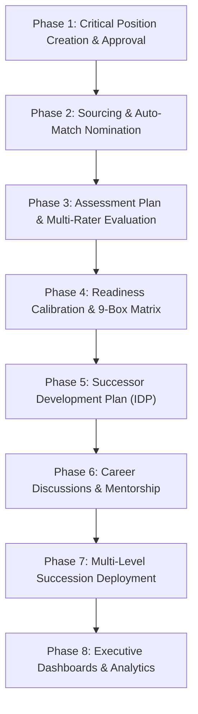
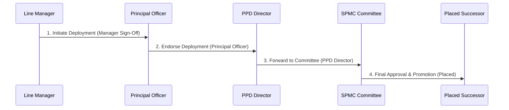

# Bunna Bank Succession Management System — End-to-End User Guide

A comprehensive, operational walkthrough of the Succession Management System for **Bunna Bank S.C.** This guide covers the entire lifecycle from identifying a Critical Position to assessing talent, managing development interventions (IDP), and executing multi-tier succession deployment.

---

## 1. Executive Summary & Flow Architecture

The succession process follows an eight-phase lifecycle designed to guarantee institutional continuity, eliminate single points of failure, and cultivate high-potential internal talent:

---

## 2. Role & Permission Matrix

| Role / Persona | System Group | Primary Responsibilities |
| :--- | :--- | :--- |
| **PPDD Officer** | `Succession: PPDD` | Critical position profiling, Auto-Match execution, assessment plan configuration, readiness calibration, IDP oversight. |
| **Line Manager** | `Succession: Line Manager` | Candidate evaluation ratings, Career Discussions, IDP milestone tracking, deployment initiation. |
| **Candidate / Employee** | `Internal User (Base)` | Invitation acceptance/declination, self-assessment reflection, IDP activity execution. |
| **SPMC Committee** | `Succession: SPMC` | Critical position validation, consensus rating review, readiness sign-off, final deployment approval. |
| **HR / Succession Admin** | `Succession: Administrator` | Master configuration (governance rules, rater weights, urgency rules, access controls). |

---

## 3. Phase 1: Critical Position Identification & Review Cycle

### 3.1. Creating a Critical Position
1. Navigate to: `Succession Management` &rarr; `Succession Pipeline` &rarr; `Critical Positions`.
2. Click **New**.
3. Complete the core identification fields:
   - **Position Title:** Select the target role (`Job Position`).
   - **Department & Division:** Auto-populated from the selected job.
   - **Incumbent:** Current employee occupying the seat (if applicable).
4. Conduct the **Vulnerability & Criticality Scoring**:
   - **Operational Impact (1–5):** Severity of disruption if the role is vacant.
   - **Vacancy Risk (1–5):** Probability of vacancy (retirement proximity, market turnover).
   - **Market Scarcity (1–5):** Difficulty in external recruitment.
   - *System Output:* The system computes the **Criticality Score**, **Risk Score**, and **Vulnerability Index**.
5. Verify **Role-Competency Mapping**:
   - The system automatically links required competencies and baseline proficiency levels (Level 1–Basic to Level 4–Expert).
6. Configure the **Periodic Review Cycle**:
   - Select **Review Frequency** (Annual, Semi-Annual, Quarterly).
   - The system schedules the **Next Review Date**.

### 3.2. Approval Workflow
- **Submit for Review:** PPDD Officer clicks `Submit for Review` &rarr; Status moves to `PPDD Review`.
- **Forward to SPMC:** PPDD Director reviews and clicks `Submit to SPMC` &rarr; Status moves to `Pending SPMC Approval`.
- **Committee Approval:** SPMC Member clicks `Approve Critical Position` &rarr; Status becomes **`Approved & Active`**.

> [!NOTE]
> Only positions in the **Approved & Active** state are eligible for candidate matching, benchmarking, and successor nomination.

---

## 4. Phase 2: Candidate Sourcing, Invitation & Nomination

### 4.1. Running the Auto-Match Engine
1. Navigate to: `Succession Management` &rarr; `Succession Pipeline` &rarr; `Auto-Match Candidates` (or click **Auto-Match Candidates** directly from the approved Critical Position form).
2. In **Target Critical Position**, choose the approved role and click **Re-Scan**.
3. The engine scans the bank's active employee database against recruitment criteria:
   - Job Grade benchmark vs required minimum grade.
   - Total experience and years of service in Bunna Bank.
   - Educational qualification & field of study match.
   - Latest PMS performance score.

### 4.2. Sourcing Invitations
1. Review the eligible candidates table.
2. Select desired candidates using the checkbox column (or click **Select All Accepted**).
3. Click **Send Invitation to Selected**:
   - Status updates to `Invitation Sent`.
   - Acceptance deadline is assigned.
4. *Direct Sourcing:* Use the **Search Candidate** card to find any employee across the bank and dispatch an individual invitation.

### 4.3. Employee Invitation Acceptance
1. The invited employee navigates to: `Employees` &rarr; `My Succession` &rarr; `Invitations`.
2. Employee reviews role expectations and clicks **Accept Invitation** (or *Decline*).
3. Status in the succession module updates to `Invitation Accepted`.

### 4.4. Pipeline Nomination
1. In the Auto-Match wizard, select the accepted candidate(s).
2. Click **Nominate Selected Candidates**.
3. Status changes to `Nominated`. A candidate assessment profile is created in **Nominated Candidates**.

---

## 5. Phase 3: Assessment Setup & Multi-Rater Competency Evaluation

### 5.1. Configuring the Assessment Plan
1. Navigate to: `Succession Pipeline` &rarr; `Nominated Candidates` &rarr; Open the candidate record.
2. Click **Configure Assessment Plan**:
   - Select evaluation components:
     - *Succession Competency Evaluation* (Weight: e.g., 50%)
     - *PMS Appraisal* (Weight: e.g., 30%)
     - *Written / Technical Exam* (Weight: e.g., 20%)
   - Choose multi-rater scope:
     - `Include Direct Manager` (Yes/No)
     - `Include Candidate Self-Assessment` (Yes/No)
     - `Include SPMC Committee` (Yes/No) &rarr; Assign specific SPMC Assessors.
3. Click **Save & Apply Plan**.

### 5.2. Multi-Rater Evaluation Process

#### A. Direct Manager Evaluation
1. Manager navigates to: `Successor Development` &rarr; `Candidate Assessments`.
2. Opens candidate and clicks **Evaluate Competencies**.
3. A guided modal displays each competency, its official definition, and 4 behavioral indicator levels.
4. Manager selects the level demonstrated (e.g., *Level 3 – Advanced*), enters observations, and clicks **Save & Next Competency**.
5. After the final competency, clicks **Submit Manager Evaluation**.

#### B. Candidate Self-Assessment (if enabled)
1. Employee navigates to: `Employees` &rarr; `My Succession` &rarr; `Assessments`.
2. Rates their demonstrated competencies and provides self-reflections.
3. Clicks **Submit Self-Assessment**.

#### C. SPMC Committee Consensus
1. Assigned SPMC members review individual inputs and record consensus ratings and deliberation notes.
2. SPMC clicks **Submit Evaluation**.

#### D. Score Aggregation
- System calculates the weighted **Final Assessment Score (0–100%)**.
- Evaluates against the configured pass mark and assigns **Assessment Result** (`Pass` or `Fail`).
- Assessment Status updates to **`Assessed`**.

---

## 6. Phase 4: Readiness Calibration & 9-Box Talent Matrix

### 6.1. System Readiness Suggestion
The system executes a multi-factor algorithm synthesizing:
1. **Final Assessment Score** (Demonstrated competency mastery).
2. **Latest PMS Score** (Operational performance history).
3. **Competency Match Percentage** (Coverage of critical requirements).
*System generates an advisory recommendation* (e.g., *Ready in 1–2 Years*).

### 6.2. 9-Box Talent Matrix Calibration
1. Navigate to: `Succession Pipeline` &rarr; `9-Box Talent Matrix`.
2. The candidate is dynamically plotted:
   - **X-Axis (Performance):** Derived from the latest PMS appraisal score.
   - **Y-Axis (Potential):** Derived from the succession competency evaluation score.
3. Candidates appear in their respective talent quadrant (*Star*, *High Potential*, *Core Talent*, etc.).

### 6.3. Official Readiness Calibration & Approval
1. PPDD Officer opens the candidate and clicks **Set Official Readiness**.
2. Selects the official readiness tier:
   - **Ready Now (0–6 Months):** Immediate successor.
   - **Ready in 1–2 Years:** Medium-term bench successor.
   - **Ready in 3–5 Years:** Long-term pipeline successor.
3. SPMC reviews the calibration and clicks **Approve Candidate (SPMC)**.
4. Candidate status advances to **`SPMC Approved`**.

---

## 7. Phase 5: Successor Individual Development Plan (IDP)

### 7.1. Automated Competency Gap Analysis
Upon assessment completion, the system compares:
$$\text{Required Level (Job Mapping)} \quad\text{vs.}\quad \text{Evaluated Level (Assessment)}$$
Any competency where the candidate scored below the benchmark is automatically logged in the **Competency Gap Review** tab.

### 7.2. Creating the IDP
1. Navigate to: `Successor Development` &rarr; `Development Plans`.
2. Click **New** (or open the linked IDP from the Candidate record).
3. Click **Generate Activities from Gaps**:
   - The system pulls every identified competency gap and creates targeted development milestones.
4. Set plan parameters:
   - **Start Date** and **Target Completion Date**.
   - **Global Prioritization & Urgency:** Select *Business Impact Score (1–10)* &rarr; *Urgency Level* is determined automatically.
   - Review each row under **Development Activities**:
     - *Development Method:* Coaching, Training, Job Rotation, Special Assignment, Certification.
     - *Milestone / Activity:* Specific action required.
     - *Target:* Measurable outcome (e.g., *Certification passed, 85%+ score*).
     - *Timeline:* Target due date for this specific milestone.
     - *Resource / Support:* Budget, mentor assignment, system access.
5. Click **Submit for Review** &rarr; PPDD approves & clicks **Activate Plan** &rarr; Status becomes **`In Progress`**.

### 7.3. Plan Governance & Milestone Execution
- **Milestone Tracking:** As milestones are executed, status progresses: `Pending` &rarr; `In Progress` &rarr; `Completed`.
- **Duration Extensions:** If additional time is needed, click **Extend Plan Duration** &rarr; Provide reason and requested new end date &rarr; Subject to PPDD approval.
- **Early Completion:** If candidate masters competencies ahead of schedule, click **Early Completion** with supporting evidence.
- **Completion Evaluation:** Line Manager completes the **Manager Completion Evaluation** and clicks **Mark Completed**.

---

## 8. Phase 6: Career Discussions & Mentorship

1. Navigate to: `Successor Development` &rarr; `Career Discussions`.
2. Line Managers / Mentors log periodic structured career discussions.
3. Record discussion date, agenda, candidate aspirations, and manager observations.
4. Select the **Discussion Outcome**:
   - *On Track with IDP*
   - *Needs Further Development*
   - *Ready for Promotion / Bench Advancement*
   - *Career Direction Change Recommended*
5. Discussion outcomes feed directly into subsequent readiness calibration cycles.

---

## 9. Phase 7: Succession Deployment & Final Placement

When a critical vacancy occurs or a successor attains full readiness:

1. **Initiation:** On the candidate form, click **Initiate Deployment / Promotion** &rarr; Status moves to `Deployment: Manager Approval`.
2. **Four-Tier Governance Sign-Off:**
   - **Tier 1 (Line Manager):** Reviews readiness and clicks **Manager Approve Deployment** &rarr; Moves to `Deployment: Principal Officer Approval`.
   - **Tier 2 (Principal Officer):** Endorses and clicks **PO Approve Deployment** &rarr; Moves to `Deployment: PPD Director Approval`.
   - **Tier 3 (PPD Director):** Verifies compliance and clicks **PPD Director Approve Deployment** &rarr; Moves to `Deployment: SPMC Final Approval`.
   - **Tier 4 (SPMC Committee):** Executes final decision and clicks **SPMC Final Approve & Place Successor**.
3. **System Outcome:**
   - Candidate status updates to **`Placed / Deployed`**.
   - The Critical Position record is updated to reflect the successor in place.
   - Position vulnerability, bench strength, and vacancy risk metrics recalculate automatically across the bank.

---

## 10. Phase 8: Executive Dashboards & Analytics

- **Succession Executive Dashboard (`Succession Management` &rarr; `Dashboard`):**
  - **Coverage Ratio:** Percentage of critical positions backed by active successors.
  - **Bench Strength:** Ratio of *Ready Now* successors vs total critical positions.
  - **High-Risk Roles:** Critical positions lacking identified successors.
  - **Pipeline Health:** Funnel breakdown from Nomination &rarr; Assessed &rarr; Approved &rarr; Placed.
- **Succession Reports Hub (`Reporting` &rarr; `Succession Reports Hub`):**
  - Pre-built executive reporting for Board of Directors and SPMC Committee.
  - Direct export to PDF and Excel formats.

---

## 11. Quick Reference: Status Flow Summary

| Entity | Stages in Sequence |
| :--- | :--- |
| **Critical Position** | `Draft (PPDD)` &rarr; `PPDD Review` &rarr; `Pending SPMC Approval` &rarr; `Approved & Active` &rarr; `Placed` (or `Deactivated`) |
| **Candidate** | `Draft / Identified` &rarr; `Nominated` &rarr; `Assessed` &rarr; `SPMC Approved` &rarr; `Deployment: LM` &rarr; `PO` &rarr; `PPDD` &rarr; `SPMC` &rarr; `Placed / Deployed` |
| **Development Plan** | `Draft` &rarr; `Submitted for Review` &rarr; `In Progress` &rarr; (`Extension Requested` &rarr; `Extended`) &rarr; `Completed` (or `Completed Ahead of Schedule`) |
| **Candidate Invitation**| `Not Invited` &rarr; `Invitation Sent` &rarr; `Invitation Accepted` (or `Declined` / `Expired`) &rarr; `Nominated` |
